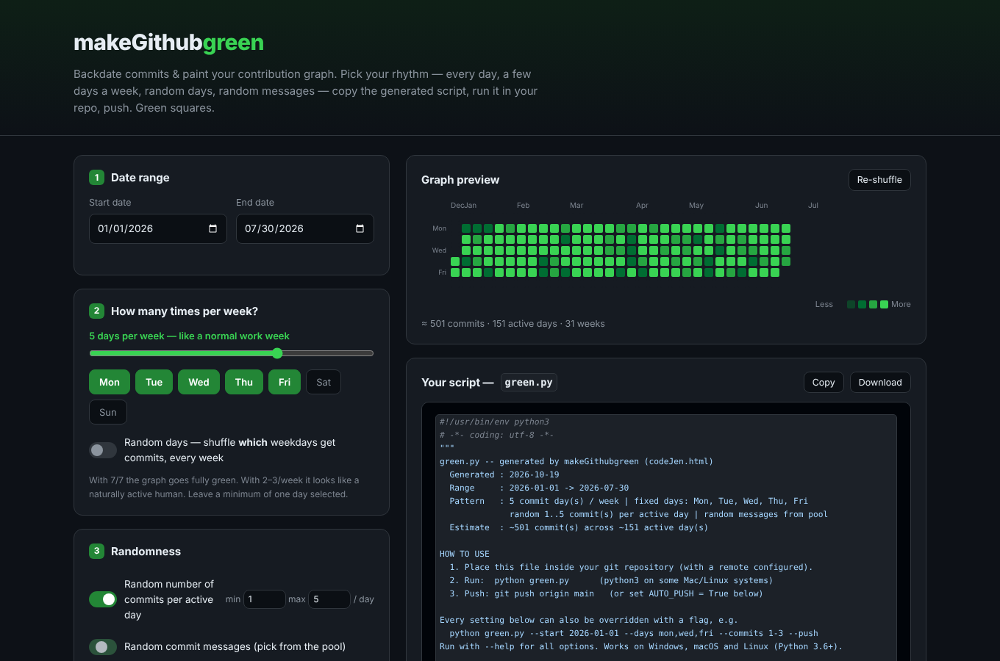
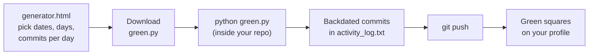
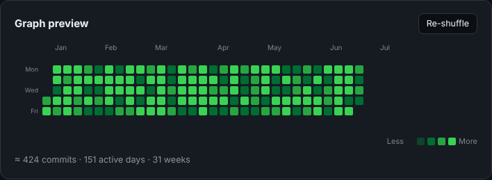

# makeGithubgreen

Backdate commits and paint your GitHub contribution graph green.
Pick a date range and a rhythm in the browser, download `green.py`, run it inside your repo, push. Green squares.

Works on **Windows, macOS and Linux**. Needs only **Python 3.6+** and **git** — no `pip install`.



---

## Contents

- [How it works](#how-it-works)
- [Prerequisites](#prerequisites)
  - [Install Python](#1-install-python)
  - [Install git](#2-install-git)
  - [A GitHub repo](#3-a-github-repository)
- [Quick start (web generator)](#quick-start-web-generator)
- [Using green.py from the command line](#using-greenpy-from-the-command-line)
- [All options](#all-options)
- [Custom commit messages](#custom-commit-messages)
- [Rewrite History (existing commits)](#rewrite-history-existing-commits)
- [Make sure the squares actually turn green](#make-sure-the-squares-actually-turn-green)
- [Does this change my git history?](#does-this-change-my-git-history)
- [Troubleshooting](#troubleshooting)

---

## How it works



`green.py` appends one line to `activity_log.txt` per commit and commits it with
`GIT_AUTHOR_DATE` / `GIT_COMMITTER_DATE` set to a day in the past. GitHub places each
square by the commit date, so once pushed, those past days light up.

| File | What it is |
|------|------------|
| `generator.html` | The generator page — open it in any browser |
| `script.js` / `style.css` | Logic and styling for the generator page |
| `green.py` | The cross-platform commit script (also what the page downloads) |
| `messages.txt` | 15 example commit messages for `--messages` |
| `rewrite.html` / `rewrite_script.js` | Rewrite History page — makes `rewrite_history.py` |
| `index.html` | Landing page |

---

## Prerequisites

### 1. Install Python

Check first — you may already have it:

```bash
python --version      # Windows
python3 --version     # macOS / Linux
```

Anything **3.6 or newer** is fine. If you get "command not found" or an older version, install it:

<details open>
<summary><b>Windows</b></summary>

**Option A — installer (recommended)**

1. Download the latest Python 3 from <https://www.python.org/downloads/windows/>.
2. Run the installer and **tick "Add python.exe to PATH"** on the first screen. This is the step people miss.
3. Click **Install Now**.
4. Open a **new** Command Prompt or PowerShell window and check:

   ```powershell
   python --version
   ```

**Option B — winget (Windows 10/11)**

```powershell
winget install -e --id Python.Python.3.12
```

**Option C — Microsoft Store:** search for "Python 3.12" and click Get.

> If `python` opens the Microsoft Store instead of running, either install from the Store or turn off the alias:
> Settings → Apps → Advanced app settings → **App execution aliases** → switch off `python.exe` / `python3.exe`.
> You can also use the launcher: `py green.py`.

</details>

<details open>
<summary><b>Linux</b></summary>

Most distributions ship Python 3 already. If not:

```bash
# Debian / Ubuntu / Linux Mint / WSL
sudo apt update && sudo apt install -y python3

# Fedora
sudo dnf install -y python3

# Arch / Manjaro
sudo pacman -S python

# openSUSE
sudo zypper install python3
```

Then check: `python3 --version`. On Linux, use `python3` in every command below.

</details>

<details>
<summary><b>macOS</b></summary>

```bash
# with Homebrew (https://brew.sh)
brew install python
```

Or download the installer from <https://www.python.org/downloads/macos/>.
Running `python3` the first time may also offer to install the Xcode Command Line Tools, which include Python 3 and git.

</details>

### 2. Install git

```bash
git --version
```

If it's missing:

| OS | Command |
|----|---------|
| Windows | Download from <https://git-scm.com/download/win> (defaults are fine) or `winget install -e --id Git.Git` |
| Debian / Ubuntu | `sudo apt install -y git` |
| Fedora | `sudo dnf install -y git` |
| Arch | `sudo pacman -S git` |
| macOS | `xcode-select --install` or `brew install git` |

Tell git who you are (use an email that's on your GitHub account):

```bash
git config --global user.name  "Your Name"
git config --global user.email "you@example.com"
```

### 3. A GitHub repository

Create a new repo on GitHub (an empty one is fine), then clone it:

```bash
git clone https://github.com/<your-username>/<your-repo>.git
cd <your-repo>
```

---

## Quick start (web generator)

1. **Open `generator.html`** in your browser (double-click the file, or use the hosted page).
2. **Set it up:**
   - **Date range** — start and end date.
   - **How many times per week** — slider or click the weekday chips. Turn on *Random days* to shuffle which days get commits each week.
   - **Randomness** — turn on *Random number of commits* and set **min / max** per day; turn on *Random commit messages* to pick from the pool.
   - **Repo details** — branch, optional git name/email, auto-push.
3. **Check the preview** — it updates live as you change things. *Re-shuffle* gives a new random pattern.

   

4. Click **Download** (saves `green.py`) or **Copy**. The script box is editable, so you can tweak it before copying.
5. **Save Preset** stores your settings in the browser; **Load Preset** brings them back next time.
6. Put `green.py` in your repo folder and run it:

   **Windows (PowerShell / Command Prompt)**
   ```powershell
   cd C:\path\to\your-repo
   python green.py
   ```

   **Linux / macOS**
   ```bash
   cd ~/path/to/your-repo
   python3 green.py
   ```

7. Push (skip if you turned on auto-push):

   ```bash
   git push origin main
   ```

The downloaded script already has your settings filled in, so it runs straight away without asking anything.

### What you'll see

```text
$ python3 green.py
Creating 11 backdated commit(s) from 2026-03-02 to 2026-03-15 on 'main'...
[████████████████░░░░░░░░░░░░░░]  54% 6/11 commits
```

```text
[██████████████████████████████] 100% 11/11 commits
Done. 11 commit(s) across 6 active day(s).
Squares turn green after pushing:
  git push -u origin main
```

And in `git log`, every commit carries a date in the past:

```text
$ git log --reverse --format='%ad  %s' --date=format:'%a %Y-%m-%d %H:%M'
Mon 2026-03-02 12:11  fix: handle edge case
Wed 2026-03-04 09:50  docs: tweak readme wording
Wed 2026-03-04 10:37  chore: update activity notes
Fri 2026-03-06 16:50  refactor: tidy up module
Mon 2026-03-09 17:51  test: extend coverage
...
```

---

## Using green.py from the command line

You don't need the web page at all — copy `green.py` (and optionally `messages.txt`) into your repo and pass flags.

> On Windows use `python`, on Linux/macOS use `python3`. Examples below use `python`.

**Interactive mode** — asks for each setting; press Enter to keep the default in `[brackets]`:

```bash
python green.py --interactive
```

```text
makeGithubgreen -- press Enter to keep the value in [brackets].

Start date (YYYY-MM-DD) [2026-01-01]: 2026-02-01
End date (YYYY-MM-DD) [2026-07-30]:
Weekdays (e.g. mon,wed,fri) or 'random' [mon,tue,wed,thu,fri]: mon,wed,fri
Commits per day (e.g. 3 or 1-5) [1]: 1-3
Branch [main]:
git user.name (blank = keep current) []:
git user.email (blank = keep current) []:
Messages file (blank = built-in) []:
Push when done? [y/N]: y
```

(The repo's own `green.py` also starts interactive mode when run with no flags at all.)

**Common recipes**

```bash
# Every weekday in the first half of 2026, one commit a day
python green.py --start 2026-01-01 --end 2026-06-30 --days mon,tue,wed,thu,fri --commits 1

# Mon/Wed/Fri, 1 to 5 commits a day (random), then push
python green.py --start 2026-01-01 --end 2026-12-31 --days mon,wed,fri --commits 1-5 --push

# Random weekdays every week, 2 commits a day
python green.py --start 2026-03-01 --end 2026-09-30 --days random --commits 2

# Full green: every day of the year
python green.py --start 2026-01-01 --end 2026-12-31 --days mon,tue,wed,thu,fri,sat,sun --commits 1-4

# Use your own messages and a different identity / branch
python green.py --messages messages.txt --name "Your Name" --email you@example.com --branch main
```

---

## All options

```text
usage: green.py [-h] [--start START] [--end END] [--days DAYS]
                [--commits COMMITS] [--branch BRANCH] [--push] [--name NAME]
                [--email EMAIL] [--messages FILE] [--interactive]
```

| Flag | Example | Description |
|------|---------|-------------|
| `--start` | `2026-01-01` | First day (YYYY-MM-DD) |
| `--end` | `2026-07-30` | Last day (YYYY-MM-DD), must not be before `--start` |
| `--days` | `mon,wed,fri` or `random` | Weekdays to commit on. `random` picks `DAYS_PER_WEEK` random weekdays each week |
| `--commits` | `3` or `1-5` | Commits per active day — a fixed number, or a range picked at random per day |
| `--branch` | `main` | Branch to commit to (switched to / created if needed). Default `main` |
| `--push` | | Run `git push -u origin <branch>` when finished |
| `--name` | `"Your Name"` | Sets `git config user.name` for this repo |
| `--email` | `you@example.com` | Sets `git config user.email` for this repo |
| `--messages` | `messages.txt` | Text file, one commit message per line. Without it the built-in list is used |
| `--interactive` | | Prompt for every setting |
| `-h`, `--help` | | Show help |

Every flag has a matching constant at the top of `green.py` (`START_DATE`, `DAYS`, `COMMITS`, `AUTO_PUSH`, …).
Edit those once and you can just run `python green.py`. There are also a few settings that are only constants:

| Constant | Default | Meaning |
|----------|---------|---------|
| `DAYS_PER_WEEK` | `5` | How many weekdays get commits when `DAYS = "random"` |
| `LOG_FILE` | `activity_log.txt` | File that gets one new line per commit |
| `RANDOM_MESSAGES` | `True` | `False` → messages like `chore(2026-03-02): update activity_log.txt (entry #1)` |
| `INTERACTIVE_IF_NO_ARGS` | `True` (repo) / `False` (downloaded) | Prompt when run without flags |

---

## Custom commit messages

`messages.txt` holds one message per line — edit it or make your own:

```text
fix: handle edge case
chore: update activity notes
docs: tweak readme wording
refactor: tidy up module
...
```

```bash
python green.py --messages messages.txt
```

On the web page, edit the *Message pool* box instead; those messages get baked into the downloaded `green.py`.

---

## Rewrite History (existing commits)

Already have real commits? `rewrite.html` spreads their dates across a range instead of adding new ones.

1. Open `rewrite.html` (or click **Rewrite History** in the header).
2. Pick the date range and a pattern:
   - **Even** — commits spread evenly across the range
   - **Random** — commits on random dates in the range
   - **Weighted** — 80% on the weekdays you select, 20% on the rest
3. Choose random times (09:00–18:00) or one fixed time, the branch, and whether to force push.
4. Enter how many commits your repo has (`git rev-list --count HEAD`) to see an accurate preview.
5. Download `rewrite_history.py` into your repo, commit or stash any changes, then run:

   ```bash
   python rewrite_history.py          # asks before changing anything
   python rewrite_history.py --yes    # no question
   ```

It reads every commit on the branch, writes a date map, rewrites the dates in one
`git filter-branch` pass with a progress bar, then runs `git push --force origin <branch>`.

> ⚠️ **This rewrites git history** — every commit gets a new hash. Anyone sharing the repo must run
> `git pull --rebase` or re-clone after the force push. Undo before pushing with
> `git reset --hard refs/original/refs/heads/main`.

---

## Make sure the squares actually turn green

- ✅ **Commit email is on your GitHub account** — GitHub → Settings → Emails. Check with `git config user.email`, or set it with `--email`.
- ✅ **Commits are on the default branch** (usually `main`) — commits on other branches don't count.
- ✅ **They're pushed** — local commits don't show up.
- ✅ **Repo is public**, or turn on *Private contributions* on your profile (Contribution settings on your profile page).
- ⏳ It can take a few minutes for the graph to update after pushing.

---

## Does this change my git history?

It **only adds** new commits on top of what's already there — nothing existing is edited, rewritten or deleted.
The new commits simply carry dates in the past, which is why the old squares light up.

```text
before:  A ── B ── C                    (your existing work)
after:   A ── B ── C ── d1 ── d2 ── d3  (new commits dated in the past)
```

Good to know:

- Anyone reading the repo history can see these commits.
- **Undo before pushing:** `git reset --hard <hash-of-C>` (find it with `git log --oneline`).
- **Undo after pushing:** reset as above, then `git push --force` — or simply delete the repo on GitHub.
- Tip: use a **separate repo** just for this so your real projects stay untouched.

---

## Troubleshooting

| Message / problem | Fix |
|-------------------|-----|
| `error: git was not found on your PATH` | Install git (see above) and open a **new** terminal |
| `error: This folder is not a git repository` | `cd` into your repo, or run `git init` and `git remote add origin <url>` |
| `error: Invalid start date ...` | Use `YYYY-MM-DD`, e.g. `2026-01-31` |
| `error: Start date ... is after end date` | Swap the dates |
| `error: Unknown weekday ...` | Use `mon,tue,wed,thu,fri,sat,sun` or `random` |
| `python: command not found` (Linux/macOS) | Use `python3` |
| `python` opens the Microsoft Store (Windows) | Install Python from python.org, or disable the App execution alias; or run `py green.py` |
| `git push failed` | Check `git remote -v`, and that you're logged in to GitHub (HTTPS token or SSH key) |
| Pushed but no green squares | Re-check [the checklist](#make-sure-the-squares-actually-turn-green) — usually the commit email |
| Weird characters instead of the progress bar | Your terminal can't show `█`; the script falls back to `#` and `-` automatically |

Press **Ctrl+C** any time to stop — commits made so far are kept.

---

Backdated commits are visible to anyone who reads the repo history — use it sensibly.
